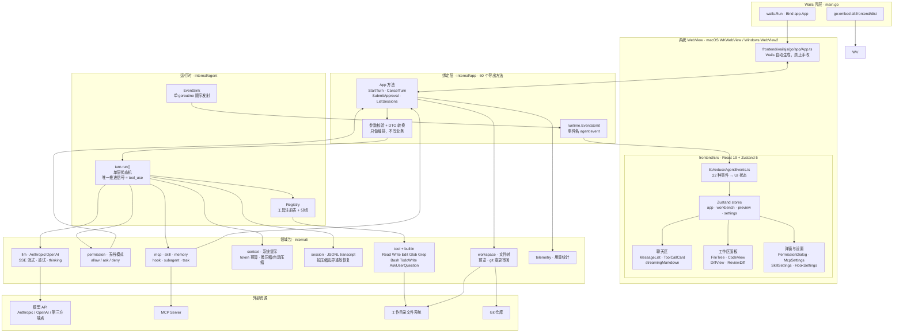
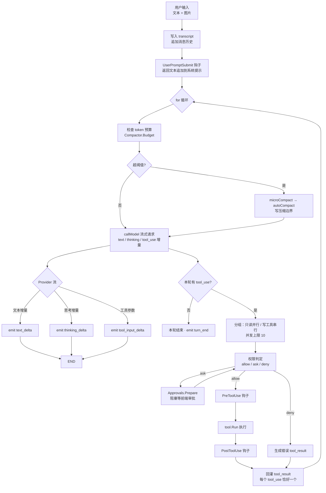

# b-desktop 架构图

> 依据当前仓库实际代码（`main.go`、`internal/app/app.go`、`internal/agent/loop.go`、`internal/agent/wiring.go`、`internal/tool/tool.go`、`frontend/src/lib/reduceAgentEvents.ts`）。

## 1. 整体分层

## 2. 一次轮次（turn）的内部循环

要点：

- **唯一推进信号是 `tool_use`**。模型不再要工具，本轮就结束；`stop_reason` 不参与控制流。
- **错误不打断循环**。工具失败、参数非法、模型请求失败都转成结构化结果回灌，由模型决定下一步；模型请求连续失败上限 3 次（`maxModelFailureRetries = 2`）。
- **事件只有 turn goroutine 一个发射者**，粒度就是 provider delta，后端不聚合文本，前端自行合帧。
